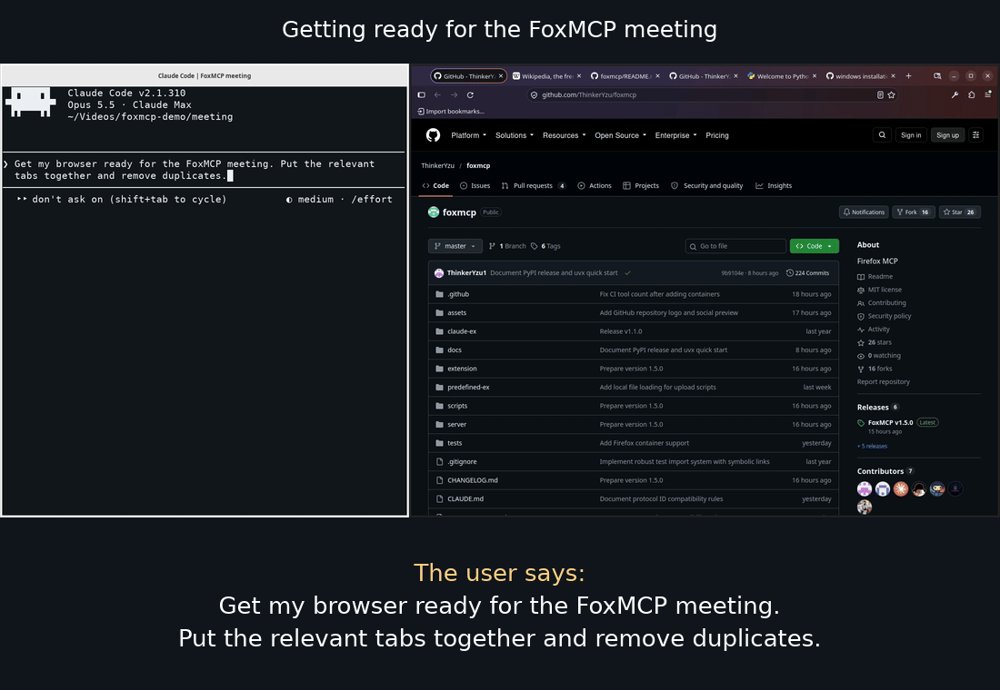

<!-- mcp-name: io.github.ThinkerYzu/foxmcp -->



*Prepare for a FoxMCP meeting with Claude Code: organize tabs, save the project
pages, and clear away distractions.*

<p align="center">
  
</p>

# FoxMCP — Firefox Browser Automation via MCP

[](https://glama.ai/mcp/servers/ThinkerYzu/foxmcp)

Connect an MCP-compatible AI assistant to Firefox. Manage tabs and windows,
read pages, upload local files, organize bookmarks, search history, and inspect
network requests.

FoxMCP has two parts: a Firefox extension and a local Python server. Your AI
client talks to the server, which sends commands to the extension.

**Privacy:** Connected AI clients can access your browser data and run page
scripts. Use trusted clients and consider a dedicated Firefox profile.
See [SECURITY.md](SECURITY.md) for the threat model.

Version 1.7.0 is published on [PyPI](https://pypi.org/project/foxmcp/1.7.0/)
and [GitHub](https://github.com/ThinkerYzu/foxmcp/releases/tag/v1.7.0).
The 1.7.0 extension update is awaiting Mozilla review;
[Firefox Add-ons](https://addons.mozilla.org/en-US/firefox/addon/foxmcp/)
currently serves 1.6.0. See [release status](RELEASES.md#v170---optional-script-approval-2026-11-07).

**Upgrading:** Update the server and extension together, restart shared workers,
and refresh your client's tool schemas. Call `profiles_list` and pass its integer
`profile_id` to every browser tool, even with one profile connected. Rediscover
targets after reconnection. See [release notes](RELEASES.md#v170---optional-script-approval-2026-11-07).

## FoxMCP or firefox-devtools-mcp?

Both let an AI agent use Firefox. They suit different jobs.

**Use FoxMCP to work in your own browser.** It is an extension in the Firefox
you already run, so the agent sees your open tabs, logged-in sites, bookmarks,
history, and containers. Nothing needs a restart, and several agents can share
the same Firefox.

**Use [firefox-devtools-mcp](https://github.com/mozilla/firefox-devtools-mcp)
to test or debug a web page.** It starts its own Firefox, so the browser is
clean and disposable. It offers console, network, debugger, and profiler tools,
and it works with Firefox for Android.

| | FoxMCP | firefox-devtools-mcp |
|---|---|---|
| Browser | The Firefox you already use | Its own instance, started for the agent |
| Logins and cookies | Yours | Only what its own profile holds |
| Several agents at once | Yes, in one Firefox | One at a time per Firefox |
| Setup | Add the extension, then `uvx foxmcp --stdio` | `npx @mozilla/firefox-devtools-mcp` |
| Best at | Tabs, windows, bookmarks, history, containers, several profiles | Console, network, debugger, profiler, Android |

firefox-devtools-mcp can also attach to a Firefox that is already running
(`--connect-existing`), but only one started with special remote-control flags.
Plain Firefox needs a restart, or a second profile, first.

**Sharing Firefox between agents.** Start each client with
`uvx foxmcp --stdio --single-instance` so they share one connection. FoxMCP
does not lock tabs, so give each agent its own window to keep them from
stepping on each other.

**Mind the access.** In your real session, a connected AI client can reach
whatever you can. Use a trusted client, consider a dedicated Firefox profile,
and read [SECURITY.md](SECURITY.md).

## Quick start

You need Firefox, an MCP client, and
[uv](https://docs.astral.sh/uv/getting-started/installation/).
Your client starts FoxMCP with `uvx foxmcp --stdio`; uv manages the Python
environment and downloads the package automatically. FoxMCP requires Python
**3.10+**.

### 1. Install the Firefox extension

Open [FoxMCP on Firefox Add-ons](https://addons.mozilla.org/en-US/firefox/addon/foxmcp/)
and click **Add to Firefox**.

Use matching server and extension versions. Click the FoxMCP toolbar icon to see
a mismatch warning with both versions inside the popup. No automatic dialog or
notification opens. The server also logs a warning. Release-version differences
are advisory when protocol IDs match; incompatible protocol IDs prevent the
browser connection. Mozilla review can delay the Add-ons version after a GitHub
release; to try a version awaiting approval, use the
[temporary add-on instructions](docs/development.md#loading-in-firefox).

### 2. Connect your AI client

For Claude Code:

```bash
claude mcp add foxmcp -- uvx foxmcp --stdio
```

For Codex:

```bash
codex mcp add foxmcp -- uvx foxmcp --stdio
```

For another MCP client, add a stdio server with command `uvx` and arguments
`["foxmcp", "--stdio"]`.

Open your AI client so it starts the server. Click the FoxMCP toolbar icon in
Firefox and check that it shows a connected status. The extension connects on
WebSocket port **8765**. If the first browser call arrives before Firefox
reconnects, retry it.

For multiple clients or chats, add `--single-instance` after `--stdio` to share
one browser connection. See [stdio setup](docs/configuration.md#serving-mcp-over-stdio).

The packaged command includes and enables the example scripts. An explicit
`FOXMCP_EXT_SCRIPTS` overrides them; an empty value disables scripts. To match a
particular extension release, use `uvx --from foxmcp==VERSION foxmcp --stdio`,
replacing `VERSION` with that release's version.

### 3. Try it

Ask your assistant to discover profiles and choose the intended one before
performing browser actions. For example:

```text
List the connected Firefox profiles and their windows/tabs.
Use the profile named Personal for the following task. If the name is ambiguous,
show me the candidates first.
List all open Firefox tabs in that profile.
Open https://example.org in a new tab.
Get the text from the current page.
Take a screenshot of the current tab.
```

To target a particular tab, right-click it in Firefox's tab bar and choose
**Tab ID = … (click to copy)**. Paste the copied `tab_id = …` into your request.
Tab IDs are local to their profile. The copied tab ID does not identify its
profile; give the assistant that context too. Rediscover after Firefox restarts.

## What you can do

| Area | Capabilities |
|---|---|
| Profiles | Discover connected Firefox profiles and address browser calls explicitly |
| Tabs and groups | List, open, close, switch, reorder, move between windows, group and ungroup; take screenshots |
| Windows | Create, close, focus, resize, position, minimize and maximize |
| Page content | Read text or HTML, execute JavaScript, run predefined scripts, load local files for uploads |
| Navigation | Go to a URL, go back or forward, reload |
| Bookmarks | List, search, create, update, move and delete bookmarks and folders |
| History | Search, list recent visits and delete entries |
| Network | Monitor requests by URL pattern; inspect headers and captured text response bodies |

Native tab groups require Firefox **139+**. Local file uploads use files readable
by the Python server; see [loading local files](docs/scripts.md#loading-local-files).
See the [API reference](docs/api-reference.md) for tool names and parameters.

## Other setup options

### Install from GitHub release archives

The GitHub installers create a local installation directory. On Linux/macOS,
you need Python **3.10+**, `venv`, `bash`, `curl`, `unzip` and `sha256sum`.
On Debian/Ubuntu, install missing prerequisites with
`sudo apt install python3 python3-venv curl unzip coreutils`.

For the GitHub archive installation, run this in a new directory where you want
FoxMCP installed:

```bash
mkdir foxmcp && cd foxmcp
curl -fSL https://github.com/ThinkerYzu/foxmcp/releases/download/v1.7.0/install-from-github.sh | bash
```

The installer verifies the release archive checksums, creates `venv/`, installs
Python dependencies, and creates `start-foxmcp.sh`. It also installs example
scripts and a `CLAUDE.md` template, and offers to connect Claude Code.

For unattended setup, save the installer outside the target directory and run
`bash /path/to/install-from-github.sh --non-interactive` from an empty directory.

**Windows (PowerShell 5.1 or newer):**\
Download both installer scripts into a separate folder, then run the installer from an empty installation folder.\
An empty folder has no installer yet, and the installer needs `install-xpi.ps1` beside it.\
Keeping both outside the target also satisfies the unattended installer's empty-folder check.

Use separate commands below: PowerShell 5.1 cannot parse `&&`, which was added in PowerShell 7.

```powershell
New-Item -ItemType Directory foxmcp-installer
$installerBase = 'https://github.com/ThinkerYzu/foxmcp/releases/download/v1.7.0'
Invoke-WebRequest -UseBasicParsing "$installerBase/install-from-github.ps1" -OutFile foxmcp-installer/install-from-github.ps1
Invoke-WebRequest -UseBasicParsing "$installerBase/install-xpi.ps1" -OutFile foxmcp-installer/install-xpi.ps1
New-Item -ItemType Directory foxmcp
Set-Location foxmcp
& ..\foxmcp-installer\install-from-github.ps1 -NonInteractive
```

Keep the two scripts together and outside the installation folder. If you already
have a source checkout, run its `scripts/install-from-github.ps1` by absolute path
from an empty folder instead. Omit `-NonInteractive` to enable interactive prompts.
The installer creates `venv/`, installs Python dependencies, creates
`start-foxmcp.ps1`, installs example scripts, and creates a `CLAUDE.md` template.

Use `start-foxmcp.ps1` for a manually started HTTP server. For MCP stdio,
configure the client to launch the installed `venv\Scripts\python.exe` with
`server\server.py --stdio` as arguments, using absolute paths. Set
`FOXMCP_EXT_SCRIPTS` to the installed `predefined-scripts` directory in the
client environment to enable the examples. The PowerShell helper reports the
direct Python command if invoked with `--stdio`.

Start the installed server manually with `./start-foxmcp.sh` on Linux/macOS
or `.\start-foxmcp.ps1` in PowerShell, then use the HTTP setup below.

### Run a shared HTTP server

Start one server and leave it running:

```bash
uvx foxmcp
```

With a GitHub archive installation, use its startup script instead.
The default ports are **8765** for the extension's WebSocket connection and
**3000** for the MCP HTTP endpoint. Check the connected status in the Firefox
extension popup.

Register the HTTP endpoint with Claude Code:

```bash
claude mcp add --transport http foxmcp http://localhost:3000/mcp/
```

Or with Codex:

```bash
codex mcp add foxmcp --url http://localhost:3000/mcp/
```

For another MCP client, add an HTTP server with URL
`http://localhost:3000/mcp/`. If the GitHub installer already connected your
client, skip registration.

### Install from source

You also need Git, `make`, and `zip` (on Debian/Ubuntu:
`sudo apt install git make zip`).

```bash
git clone https://github.com/ThinkerYzu/foxmcp.git
cd foxmcp
make install
make package
```

[Load the built extension in Firefox](docs/development.md#loading-in-firefox),
then start the server with `make run-server`. Continue with
[HTTP setup](#run-a-shared-http-server) above.

### Let your client start the server

Use stdio with `--single-instance` to start the server automatically and share it
across chats. Configure each client to launch
`venv/bin/python server/server.py --stdio --single-instance`, using absolute paths.
Clients discover and share the browser connection on the extension port. They
join an existing server or start a background worker automatically. Closing one
chat leaves the others connected. Automatic workers stop after 60 seconds without
clients; manually started servers keep running. On Windows, use `venv\Scripts\python.exe`.
See [stdio setup](docs/configuration.md#serving-mcp-over-stdio).

## Configuration

Click the FoxMCP toolbar icon to change extension connection settings. If you
change the WebSocket port, change it on both the extension and the server.
Host/Port and Reconnect Interval save automatically after a 500ms pause. Reset
persists defaults immediately. Retries use a constant interval (1000ms by
default, configurable from 100 to 30000ms); there is no manual Reconnect button.
Both Popup and Options show actual connection and protocol status. See
[extension configuration](docs/configuration.md#configuring-extension).

With `uvx`, pass server options after `foxmcp`:

```bash
# Custom WebSocket and MCP HTTP ports
uvx foxmcp --port 9000 --mcp-port 4000

# Hide tool groups from clients
uvx foxmcp --disable-tools bookmarks,history

# Hide a group but keep its screenshot tool
uvx foxmcp --disable-tools tabs --enable-tools tabs_capture_screenshot
```

For a client-managed stdio server, include the same options in its launch
command, for example:

```bash
uvx foxmcp --stdio --single-instance --disable-tools bookmarks,history
```

For a GitHub archive or source installation, the same options follow
`venv/bin/python server/server.py`. Run from that installation directory:

```bash
venv/bin/python server/server.py --port 9000 --mcp-port 4000
```

Use `profiles_list` first to inspect all connected Firefox profiles, their real
names, windows and tabs. Every browser command requires the chosen `profile_id`
alongside its window/tab IDs. Profiles can share the same server port without
replacing each other. The server assigns positive integer IDs from 1. IDs change on every reconnect;
rediscover after a disconnect or server restart. Update both extension and server for
protocol 3. Follow the [multiple-profile setup](docs/configuration.md#connecting-multiple-firefox-profiles-to-one-server)
to connect each Firefox instance, then use
[profile discovery](docs/api-reference.md#firefox-profiles) to choose a target.

All **47 tools** are enabled by default. Available groups are `profiles`, `windows`, `tabs`,
`containers`, `bookmarks`, `navigation`, `content`, `requests`, `history`, and `debug`.
See [configuration](docs/configuration.md) for client examples and other options.

## Firefox containers

Use `containers_list` to discover named containers and their opaque
`cookie_store_id` values. Pass one to `tabs_create` to open in that container,
or to `tabs_list` to filter. Use `firefox-default` for normal browsing. Omission
keeps existing behavior; invalid selections fail without opening a fallback tab.

`containers_create`, `containers_update` and `containers_remove` manage persistent
profile containers. Removal clears stored site data and refuses containers with
open tabs. Containers survive client disconnects. See the
[API reference](docs/api-reference.md#firefox-containers) for details.

The extension requires `contextualIdentities` and `cookies` permissions for
container APIs and tab selection. Installation can enable Firefox containers;
subsequent disabling is respected. Update both extension and server together.

## Predefined scripts

External executable scripts can generate JavaScript for FoxMCP to run in a tab.
The release installer configures the examples in `predefined-scripts/`; the
packaged `foxmcp` command uses its bundled examples by default. Both include
DOM summaries, YouTube controls, calendar extraction, and a file-input helper.
Ask your assistant which predefined scripts are available.

For your own scripts, set `FOXMCP_EXT_SCRIPTS` to their directory **before starting
the server**. For example, save this as `get-title.sh` in that directory and run
`chmod +x get-title.sh`:

```bash
#!/bin/bash
# Return the current page title.
echo 'document.title'
```

Then ask your assistant to run `get-title.sh` in a tab. Restart the server after
adding scripts to refresh the list shown to clients. See the
[script guide](docs/scripts.md) for arguments, setup, and file upload examples.

## Troubleshooting

| Problem | Check |
|---|---|
| Extension disconnected | Start the server and check the host/port in the FoxMCP popup. `curl -i http://localhost:8765` should return **426 Upgrade Required**. |
| MCP client cannot connect | Check its URL. `curl -i http://localhost:3000/mcp/` should return a **307** redirect when using HTTP mode. |
| Server logs “address already in use” | Another service owns a port. FoxMCP can keep running even when its MCP listener fails; use [different ports](docs/development.md#port-conflicts) and check both listeners. |
| Server reports missing Python packages | Use `venv/bin/python`, or the provided startup script. |
| Built extension will not install | Follow the [Firefox channel and signing guidance](docs/development.md#loading-in-firefox). |

For other errors, run the server in the foreground and inspect its output.

## Documentation and development

- [Configuration](docs/configuration.md) — ports, MCP clients, tool selection and reconnect behavior
- [API reference](docs/api-reference.md) — all tools and parameters
- [Scripts](docs/scripts.md) — reusable automation and local file uploads
- [Request monitoring](docs/web-request-monitoring.md) — filters, response bodies and monitor lifetime
- [Development](docs/development.md) — extension installation, builds, tests and release workflow
- [Architecture](docs/architecture.md) and [protocol](docs/protocol.md) — how the components communicate
- [Release notes](RELEASES.md) and [changelog](CHANGELOG.md) — updates and upgrade instructions
- [Security](SECURITY.md) — trust boundaries and vulnerability reporting

See [CONTRIBUTING.md](CONTRIBUTING.md) for contribution and test setup guidelines.

**Coding agents:** Read [CLAUDE.md](CLAUDE.md) before making changes.

Licensed under the [MIT License](LICENSE).
