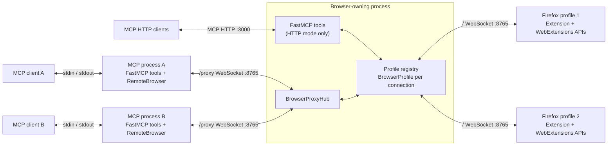

# FoxMCP Architecture

Overview of the FoxMCP system architecture, components, and data flow.

## System Overview

One browser-owning process listens on the configured extension port (8765 by
default). It can serve MCP clients directly and accept browser commands from
separate MCP stdio processes at the same time.



The browser owner's `/discovery` HTTP route shares port 8765 with `/proxy` and
the extension WebSockets. Each stdio process uses it before opening its proxy
connection. Port numbers shown are defaults.

Each `--stdio --single-instance` client launches its own MCP process. That
process discovers the browser owner and forwards browser commands to it. If no
owner exists, it starts a detached worker with no MCP transport. An existing
manual HTTP or plain stdio server can also be the owner. The diagram's HTTP
listener exists only when the owner runs in HTTP mode.

Plain `--stdio` combines FastMCP and browser ownership in one client process;
`--no-mcp` serves the browser listener without a direct MCP transport. Only the
owner binds the extension port. Firefox profiles each open their own extension
WebSocket to `/` on that port. MCP clients discover connected profiles and
address every browser call with a `profile_id`; there is no active-profile
default. See [profile discovery](api-reference.md#firefox-profiles).

## Component Architecture

### 1. Firefox Extension

**Location**: `extension/`

**Manifest**: Manifest V2, extension ID `foxmcp@codemud.org`.

#### Background Script (`background.js`)
- **Persistent Background Page**: Declared `"persistent": true` in the manifest, so it runs for the lifetime of the browser session (this is a background page, not a service worker)
- **WebSocket Client**: Maintains the connection to the Python server and reconnects when it drops
- **Action Router**: Splits each incoming action on `.` and dispatches to the handler for that namespace
- **Response Manager**: Formats and sends responses back to the server

#### Content Script (`content.js`)
- **Page Injection**: Injected into all pages (`<all_urls>`) for content access
- **JavaScript Execution**: Executes custom scripts in page context
- **DOM Interaction**: Extracts text, HTML, and manipulates page content
- **Communication Bridge**: Relays data between page and background script

#### Shared settings UI

`config.js` supplies defaults, validation, test overrides and URL construction.
The persistent background owns serialized storage operations, the 500ms save
debounce and connection state. `settings.js` is shared by Popup and Options;
`popup/popup.js` and `options.js` only adapt their DOM elements. Both views poll
background status every second without overwriting unfinished edits. Shared
styling lives in `settings.css`, with small page-specific CSS files.

Settings are kept in `storage.sync`. Host/Port form one validation group and the
interval forms another. Reset persists defaults without a modal and preserves
test overrides. See [configuration](configuration.md#configuring-extension)
and the [file map](files.md#extension-directory).

### 2. Python Server

#### Registry and browser connections

`server.py` keeps a registry of `BrowserProfile` objects keyed by `profile_id`.
Each object in `browser_profile.py` owns one socket, pending reply futures,
release diagnostics and monitor ownership. Registration validates protocol 3
and assigns a new integer ID. The extension never handles this ID; it is stripped
from commands before forwarding. Unrelated profiles stay connected when one
disconnects.

`profile_names.py` resolves display names from local Firefox metadata without
modifying it. Registered INI names take precedence over group labels; on Linux,
held profile locks can distinguish running profiles from stale UUID copies.
Names may be missing, ambiguous or duplicated and are never
routing keys. See the [handshake](protocol.md#profile-connections-protocol-id-3).

#### MCP Tools (`mcp_tools.py`)

FastMCP exposes 46 tools by default. `profiles_list` and
`debug_websocket_status` are untargeted; every browser tool requires a positive
integer `profile_id`. `_send(profile_id, request)` adds routing metadata before forwarding
to the registry. Native tab/window/group/container/monitor IDs are meaningful
only within the chosen profile. Unknown or disconnected targets return errors
without selecting another profile.

In an owning process, tools call `FoxMCPServer` directly. In a shared stdio
process, `single_instance.run_proxy` supplies a `RemoteBrowser` instead. The
same tools run locally in either case: tool filtering, predefined-script
selection/execution, file grants and MCP result formatting belong to the
process serving that MCP client. Only browser commands, profile discovery and
connection-status queries cross `/proxy`. The owner's tool configuration does
not limit the browser actions available to forwarding clients.

### Firefox containers

The extension resolves opaque cookie-store IDs against the connected profile.
Tab listings carry store metadata, and explicit tab creation uses
`tabs.create_in_store`, allowing older extensions to reject it before navigation.
The server verifies the actual returned store. Container lifecycle tools use
`contextualIdentities`; no per-client container registry or cleanup is required.
Containers and their tabs survive client and forwarding-worker lifetimes.
Protocol ID 2 covers the changed tab-list contract. See [protocol](protocol.md#firefox-container-contract-protocol-id-2).

### 3. Communication Protocols

#### Local file transfer

`content_load_file` opens a regular file in Python and creates a temporary
single-use HTTP grant on an on-demand loopback listener. `content.load_file`
sends only the URL, file ID and basename/MIME/size/mtime metadata over the
WebSocket. The extension background page fetches the response as a Blob and
wraps it in a File, preserving Firefox's disk-backed blob storage. Extension
messaging structured-clones it to the target document's isolated content-script
scope, where scripts access it through `globalThis.foxmcpFiles`.

A preparation message marks the target document before fetching. If the tab
navigates during the transfer, its replacement document rejects delivery. File
handles expire after five minutes and should be deleted by the consuming
script. Private tabs are refused. Page-specific input assignment stays in
predefined scripts; see [scripts.md](scripts.md#loading-local-files).

The HTTP service uses standard-library threads and 64 KiB read/write blocks,
without an extra dependency or a fixed port. It runs independently of the MCP
transport, including stdio. Host/Origin checks and opaque one-use grants keep
the endpoint from acting as a directory server. It grants no CORS access and
is closed when its owning MCP process shuts down. In shared stdio mode, that
process supplies its own `FileTransferServer` to `RemoteBrowser`: only the grant
URL and metadata pass through `/proxy` and the selected extension fetches the
file directly from the originating process. File bytes do not pass through the
browser owner's proxy.

#### WebSocket Protocol
```json
{
  "id": "unique-request-id",
  "type": "request|response|error",
  "action": "namespace.function",
  "data": {},
  "timestamp": "ISO-8601"
}
```

The browser envelope above is sent only to the selected extension. MCP calls
and `/proxy` requests also carry `profile_id` as routing metadata. Both peers
must complete the protocol-3 `hello`/`ready` handshake before browser requests
are accepted. Release-version warnings are advisory; protocol-ID mismatch is
refused. See [protocol](protocol.md#profile-connections-protocol-id-3).

Actions are namespaced with a dot — `windows.get`, `tabs.list`, `bookmarks.create`, `requests.start_monitoring`. The prefix selects the handler in the extension. See [protocol.md](protocol.md) for the full specification.

#### MCP Protocol
- **Standard MCP Tools**: Browser functions exposed as MCP tools
- **Parameter Schema**: Type-safe parameter definitions
- **Result Formatting**: Consistent response formatting
- **Error Codes**: Standardized error handling
- **Transport**: HTTP on port 3000 by default, run by uvicorn in a thread of its
  own. `--stdio` serves the same tools on the process's stdin and stdout instead,
  for clients that launch their servers; there the MCP server is an asyncio task
  beside the WebSocket server rather than a thread, since the stdio transport is
  asyncio throughout. These describe direct browser-owning modes; shared stdio
  runs FastMCP locally and connects to the owner's browser listener instead of
  binding another one

HTTP tool calls cross from uvicorn's event loop to the browser listener's loop
using `asyncio.run_coroutine_threadsafe`. Registry access, extension sockets and
pending reply futures stay on that browser loop, shared by direct HTTP calls
and incoming proxy calls.

#### Shared stdio server

`single_instance.py` probes `/discovery` on the configured extension port and
checks the server identity, protocol ID and proxy path. It then opens `/proxy`
and validates its greeting before serving MCP over stdio. Incompatible owners
are refused. `/` remains the extension connection; manual HTTP, plain stdio and
browser-only servers expose the same discovery and proxy routes. See the
[route and envelope contracts](protocol.md#discovery-and-proxy-routes).

`BrowserProxyHub` in `browser_proxy.py` handles each proxy independently. It
validates requests and starts a task per request so replies may arrive out of
order. `proxy.profiles` and `proxy.status` are handled by the owner; other
requests go through its profile registry. Each forwarded command gets a fresh
upstream request ID, and its reply restores the original client's ID. Thus two
clients may use the same ID without mixing replies. A client cannot reuse an
ID already in flight on its own proxy connection.

The target `profile_id` reaches the registry unchanged, then `BrowserProfile`
strips it before sending to Firefox. The response is annotated with that
profile's ID and connection identity for ownership tracking. Each profile keeps
its own pending replies and monitors. Monitor ownership follows the proxy
socket, separately from direct MCP HTTP sessions. On proxy disconnect,
outstanding requests finish before cleanup so a late monitor-creation reply
cannot leave an abandoned capture running.

When discovery finds no owner, a detached worker tries to bind the configured
extension port. The listening socket elects the owner; a losing contender exits
and its client retries discovery. There is no discovery file, file lock or
separate internal listener. Automatic workers exit after 60 seconds without
proxies by default, configurable with `--single-instance-idle-timeout`. Firefox
connections alone do not keep them alive. Manual owners retain their existing
lifetime. A worker failure requires existing MCP clients to reconnect; the next
client launch can start a replacement. Browser commands are never replayed.

On Windows, the local WMI provider starts the worker outside the client's Job
Object. A hidden PowerShell broker passes the environment over stdin and waits
for the worker's exit. This prevents SDK process-tree cleanup from terminating
the shared worker. See [configuration](configuration.md#sharing-one-server-across-chats).

## Data Flow

### 1. MCP Client → Browser

```text
Direct HTTP or plain stdio:
  MCP client -> FastMCP tool -> FoxMCPTools._send(profile_id, request)
             -> FoxMCPServer registry -> selected BrowserProfile
             -> extension WebSocket -> WebExtensions API

Shared stdio:
  MCP client -> local FastMCP tool -> FoxMCPTools._send(profile_id, request)
             -> RemoteBrowser -> /proxy WebSocket -> BrowserProxyHub
             -> fresh upstream request ID -> FoxMCPServer registry
             -> selected BrowserProfile -> extension WebSocket -> WebExtensions API
```

For both paths, the selected `BrowserProfile` matches the extension reply to its
pending future. Direct calls return to the local tool. Proxy replies restore
the client's request ID, then `RemoteBrowser` resolves the local tool's future.
The tool formats the MCP result for its client. Routing metadata never becomes
an extension action parameter. Missing or disconnected profiles fail without
sending the command to another profile.

`profiles_list` takes the same direct or remote path to the owner's registry;
the remote path uses `proxy.profiles`. Discovery can query each connected
profile for its windows and tabs without choosing a default profile.

### 2. Predefined Scripts Flow

```text
MCP client -> content_execute_predefined in its MCP-serving process
           -> validate and run local external script
           -> script stdout supplies JavaScript
           -> content.execute_script with explicit profile_id and tabId
           -> direct registry call OR RemoteBrowser /proxy forwarding
           -> selected Firefox extension -> isolated content-script context
           -> execution result returns along the request path
           -> local tool formats the MCP response
```

Each shared stdio process uses its own `FOXMCP_EXT_SCRIPTS` directory and runs
its own script subprocesses. The browser owner receives the generated browser
command, while executable lookup and execution stay with the originating MCP
process. See [scripts.md](scripts.md).

## Security Architecture

### 1. Network Security
- **Localhost Binding**: The server binds to `localhost` by default, and `--host` is forced back to localhost if given anything else
- **No External Access**: Not reachable from the network in the default configuration
- **Port Separation**: WebSocket and MCP listen on different ports

**Localhost binding excludes the network, not web pages.** A page the user visits runs inside their browser, so it can reach `127.0.0.1` — the same-origin policy does not stop it, and WebSocket handshakes are never preflighted. Each port handles this differently:

| Port | What stops a web page |
|---|---|
| Browser port | Route checks require a loopback peer and a valid localhost Host (forwarded ports allowed). `/` requires a `moz-extension://` origin; `/discovery` and `/proxy` reject every Origin header. No CORS allowance is sent. Proxies cannot enter the extension handler. |
| MCP HTTP | No CORS headers are sent, so preflighted requests are blocked; a `text/plain` request that would skip preflight is rejected for its content type; and the transport requires a session id that cross-origin JavaScript cannot read. These come from `fastmcp`/uvicorn rather than from FoxMCP, so `tests/integration/test_mcp_port_not_web_reachable.py` asserts them — a dependency upgrade that re-opens the port fails the suite |

Neither port authenticates local processes, which is deliberate — a process running as the user already has the browser profile and the script directory, so a shared secret between two components under that user's control would guard nothing.

### 2. Extension Security
- **Broad Permissions**: The extension requests `tabs`, `tabGroups`, `menus`, `clipboardWrite`, `windows`, `history`, `bookmarks`, `activeTab`, `storage`, `webRequest`, `webRequestBlocking`, and `<all_urls>`. `clipboardWrite` is there for the tab context menu's copy item, which writes a tab ID to the clipboard; nothing reads the clipboard. `webRequestBlocking` is there for `filterResponseData`, which is the only way to read a response body and which Firefox grants only to an extension holding that permission; no listener blocks, cancels or rewrites a request. The set is deliberately wide — the extension exists to expose browser state — and it is the reason the server must stay on localhost. Treat an installed FoxMCP as granting its MCP client the same reach over the browser that you have.
- **Sandboxing**: Content scripts run in the standard isolated content-script context

### 3. Script Security

Enforced in `mcp_tools.py` before a predefined script runs:

- **Directory selection**: Source startup requires `FOXMCP_EXT_SCRIPTS`; the installed console command defaults to bundled examples when it is absent. An explicit value overrides the bundle, including an empty value to disable scripts.
- **Name Filtering**: Script names must match `^[a-zA-Z0-9._-]+$` and may not contain `/`, `\`, or `..`
- **Path Containment**: The resolved absolute path must stay inside the scripts directory
- **Executable Check**: The file must exist and be executable
- **Timeout Protection**: Scripts are killed after 30 seconds
- **Execution Isolation**: Scripts run as separate subprocesses
- **Audit Logging**: Every invocation is logged at `INFO` with script name, arguments and tab; every refusal and failure at `WARNING`. Arguments are truncated at 120 characters; the generated JavaScript is never logged, only its size. See [`scripts.md`](scripts.md#what-gets-logged)

### 4. Extension Connection Origin

Only browser extensions may connect to `/`. The origin pattern is:

```python
EXTENSION_ORIGIN_PATTERN = re.compile(r'moz-extension://.+')
```

- **Scheme, not identity**: Firefox generates a per-install UUID, so the extension's origin differs on every profile — `moz-extension://8690897d-…` on one machine, something else on the next. Matching the scheme lets any legitimate install pass
- **Rejected before registration**: Origin validation runs before the extension handler. The protocol handshake then rejects incompatible registrations. The server assigns a fresh integer profile ID to each accepted connection without replacing existing profiles.
- **Matched with `fullmatch()`**: The trailing `.+` is required; a bare prefix pattern rejects everything, including the extension
- **Rejections are logged** at warning level with the offending origin. The library logs them only in debug mode, which would make a legitimate extension that stopped connecting look identical to a server that was never reached

This does not stop a *malicious installed extension*, which can send a `moz-extension://` origin of its own. That is a different threat — it requires the user to install hostile software, at which point the browser is already compromised.

Tested in `tests/integration/test_connection_origin.py`. Test clients standing in for the extension must use `connect_as_extension()` from `tests/test_config.py`; a plain `websockets.connect()` is refused.

## Concurrency and Limits

### 1. Connection Management

- Each connected profile has its own socket and connection identity.
  Server-assigned integer profile IDs change on every socket reconnect and are
  never reused during a server lifetime.
- MCP clients can address the same or different profiles concurrently. They do
  not share an active-profile setting. Monitor ownership is tracked per client
  and browser connection.
- The extension reports Connected after a matching `ready` acknowledgment, not
  merely after the socket opens. Protocol errors stop retries and are visible
  in both UI views; release-version mismatches only warn.
- Ordinary connection failures retry indefinitely at the configured constant
  interval: 1000ms by default, from 100 to 30000ms. Endpoint edits reconnect;
  interval edits preserve healthy sockets and reschedule a pending retry.
  Obsolete timer callbacks and old socket events cannot disturb a replacement
  connection. See [configuration](configuration.md#tuning).

### 2. Request Handling

- Requests may interleave within and across profiles. Each `BrowserProfile`
  matches replies by ID in its own `pending_requests` map.
- `send_request_and_wait` defaults to 30 seconds and returns an error dictionary
  on timeout. Callers check for errors before consuming response data.
- Disconnect fails that socket's pending requests and drops its ownership state.
  The extension sends a response only on the socket that received its request.
- Request monitors are cleaned up when their owning client or profile connection
  disappears. Containers and bookmarks are persistent browser data, not client
  resources. See [monitor lifecycle](web-request-monitoring.md#how-long-a-monitor-lives).

### 3. Known Limits

- Commands are not queued, replayed or redirected after a target disconnects.
- Results are not cached; every browser call makes a fresh round trip.
- The browser owner's listener uses the WebSocket library's default incoming
  message-size limit. `RemoteBrowser` connects with `max_size=None` for incoming
  proxy replies; this does not remove the owner's incoming limits.

## Extension Points

### 1. Adding New Browser Functions

Both halves must be changed. One without the other is a silent failure.

**Step 1: Extension** (`background.js`) — add a `case` to the handler for the namespace, or a new `handle<Namespace>Action` function plus a `case` in `handleMessage`'s router:

```javascript
case 'windows.new_function':
  if (!data.windowId) {
    sendError(id, 'INVALID_PARAMETER', 'windowId is required for windows.new_function');
    return;
  }
  const result = await browser.windows.someFunction(data.windowId);
  sendResponse(id, action, { result });
  break;
```

**Step 2: MCP Tool** (`mcp_tools.py`) — register the tool and build the request explicitly:

```python
@self._tool()
async def new_function(profile_id: int, window_id: int) -> str:
    """New browser function

    Args:
        profile_id: Target from profiles_list.
        window_id: The ID of the window

    Returns:
        String describing the outcome
    """
    request = {
        "id": str(uuid.uuid4()),
        "type": "request",
        "action": "windows.new_function",
        "data": {"windowId": window_id},
        "timestamp": datetime.now().isoformat()
    }

    response = await self._send(profile_id, request)

    if "error" in response:
        return f"Error: {response['error']}"

    return f"Result: {response.get('data', {}).get('result')}"
```

**Step 3**: add the permission to `manifest.json` if the API needs one, document the action in [protocol.md](protocol.md) and the tool in [api-reference.md](api-reference.md), and add an integration test.

### 2. Custom Script Integration

A predefined script is a program whose **stdout is JavaScript**. The server runs it, then injects what it printed.

**Script Creation**
```bash
#!/bin/bash
echo "(function() { return 'Custom functionality'; })()"
```

**MCP Tool Usage**
```python
result = content_execute_predefined(
    profile_id=profile_id,
    tab_id=123,
    script_name="custom_script.sh",
    script_args='["arg1", "arg2"]'
)
```

See [scripts.md](scripts.md) for the full guide.

## Testing Architecture

### 1. Unit Tests
- **Server Components**: Test individual server functions
- **Protocol Validation**: Test message format validation

### 2. Integration Tests
- **End-to-End**: Test complete MCP → Browser flow
- **Extension Communication**: Test WebSocket communication
- **Browser APIs**: Test actual browser function calls with real Firefox
- **Script Execution**: Test predefined script execution

### 3. Test Infrastructure
- **Centralized Fixtures**: Shared test setup in `conftest.py`
- **Port Coordination**: `port_coordinator.py` allocates ports dynamically, and `FoxMCPServer` detects pytest to avoid the default MCP port — so the suite can run while a development server is up
- **Firefox Management**: Automated temporary profile creation and extension installation via `setup_and_start_firefox()`
- **Cleanup**: Automatic resource cleanup after tests

## Configuration Architecture

### 1. Server Configuration

Constructed in code:

```python
server = FoxMCPServer(
    host="localhost",      # Security: localhost only
    port=8765,             # WebSocket port
    mcp_port=3000,         # MCP server port (None → 3000, or dynamic under pytest)
    start_mcp=True,        # Enable MCP integration
    use_stdio=False        # True: serve MCP on stdin/stdout without an MCP HTTP port
)
```

Or from the command line:

```bash
python server/server.py --host localhost --port 8765 --mcp-port 3000
python server/server.py --no-mcp          # WebSocket only
python server/server.py --stdio           # MCP on stdin/stdout, owns browser listener
python server/server.py --stdio --single-instance  # Local MCP, join/start browser owner
```

### 2. Extension Configuration
- **storage.sync**: Persistent configuration across browser restarts
- **UI Configuration**: Real-time configuration via popup and options page
- **Test Overrides**: Development configuration overrides
- **Auto-reconnection**: Automatic reconnection on setting changes

### 3. Environment Configuration

```bash
# Select custom predefined scripts (required for direct source startup)
export FOXMCP_EXT_SCRIPTS="/path/to/scripts"
```

The console wrapper defaults this variable to bundled examples only when it is
absent. `FOXMCP_DISABLE_TOOLS` and `FOXMCP_ENABLE_TOOLS` select tools; see
[configuration.md](configuration.md). Host and ports are set through the
constructor or command-line flags above.

## Deployment

### 1. Development

```bash
make dev                # Setup environment
make build              # Build extension
make run-server         # Start server
```

### 2. Distribution
- **Extension Packaging**: XPI file, published to the Firefox Add-ons store and attached to GitHub releases
- **Server**: The Python wheel/sdist installs the existing `server/` modules as `foxmcp`, with executable examples under `foxmcp/examples` and a `foxmcp` console entry point. Source startup and `scripts/install-from-github.sh` remain supported; PyPI publication status is in the [README](../README.md#run-with-uvx-over-stdio).
- **Versioning**: Extension and server are released together — the WebSocket protocol is the compatibility boundary between them

### 3. Observability

Python `logging` at INFO level uses the default text format on stderr, keeping
stdio stdout available for MCP messages. Detached workers append stderr to
`instance-PORT.log` in the per-user runtime directory; see
[worker log locations](configuration.md#sharing-one-server-across-chats).
`/discovery` reports the owner's identity, protocol ID, PID and lifetime for
startup discovery. There is no dedicated health endpoint, metrics collection or
structured log format.

## Future Architecture Considerations

These are not implemented. They are recorded as directions that have been considered, not as plans.

### 1. Multi-Browser Support
- **Browser Abstraction**: Common interface for different browsers
- **Protocol Standardization**: Browser-agnostic messaging
- **Extension Variants**: Browser-specific extension implementations

### 2. Production Hardening
- **Health Checks**: HTTP health endpoints for the WebSocket and MCP servers
- **Metrics**: Connection counts, request rates, response times, error rates
- **Structured Logging**: JSON-formatted logs with request tracing across components
- **Containerization**: A Docker image bundling the server and its dependencies

### 3. Enhanced Security
- **Authentication**: User authentication for MCP clients
- **Authorization**: Role-based access control over the tool surface
- **Audit Logging**: A record of which client invoked which tool
